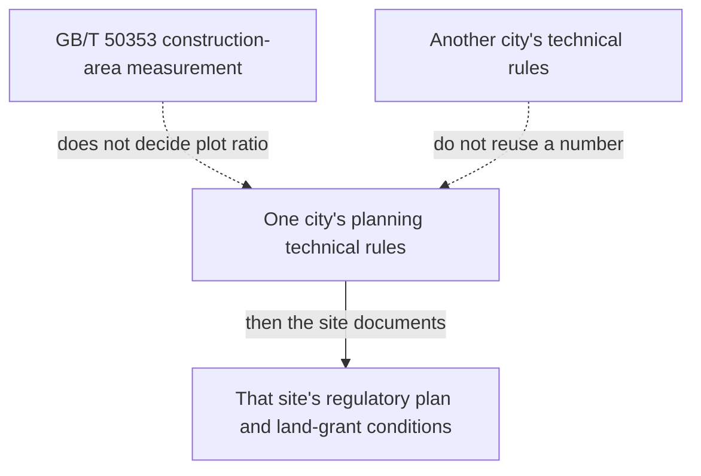
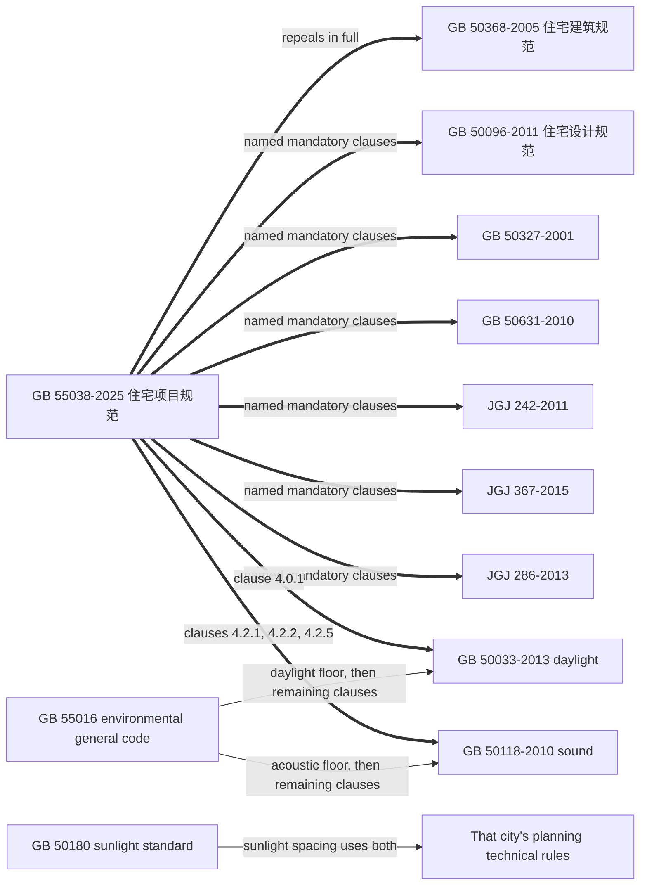
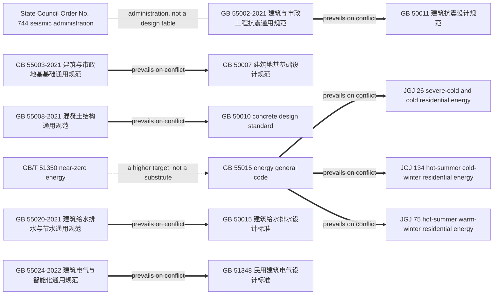

# Statutory document relationships

How the instruments in the statutory source register relate. GB is Guobiao (国家标准, national standard). GB/T is a recommended national standard (推荐性国家标准). JGJ is a Ministry of Housing and Urban-Rural Development (住房和城乡建设部) professional standard (行业标准). A thick arrow starts at the instrument that repeals the other or prevails where they conflict. A solid arrow is the order to read them. A dotted arrow is a limit: that document does not decide the number at the arrowhead. A plain line means the two sit side by side. Clause numbers below are the repeal facts already recorded from the public announcements. They are not a substitute for opening the saved file.

## How a planning number is read

Plot ratio (容积率), site coverage (建筑密度), green ratio (绿地率), spacing, and parking come from one city's technical rules, then from that site's own documents. GB/T 50353 measures construction area. It does not decide what counts toward plot ratio.

<!-- mermaid:id=planning-read-order -->

## Six city instruments, kept apart

Beijing, Shanghai, Guangzhou, and Hangzhou are saved under reference/statutory-sources/cities/. Shenzhen's 2025 notice returned HTTP 403. Chengdu's adopted 2024 text has no confirmed bureau URL. None of these cities lends a number to another.

```mermaid
flowchart LR
  accTitle: Six city instruments, kept apart
  accDescr: Six independent city chains. Beijing's 2020 notice keeps the 2003 rules in force except a later reform. Shanghai Order 52 reissues Order 12. Guangzhou Order 168 revises Order 71. Shenzhen and Chengdu are named but not saved. Hangzhou's 2026 rules cover the urban built-up area.
  beijingNotice["Beijing 2020-07-27 continuance notice"]
  beijingTongze["市规发〔2003〕514号 北京地区建设工程规划设计通则"]
  beijingRepeal["京规自发〔2018〕11号 repeal notice"]
  shanghai52["Shanghai Government Order No. 52 &#40;2010&#41;"]
  shanghaiRules["上海市城市规划管理技术规定（土地使用、建筑管理）"]
  shenzhenNotice["Shenzhen notice 2025-11-03, page not saved"]
  shenzhenRules["深圳市城市规划标准与准则（修订汇总版）"]
  guangzhou168["Guangzhou Government Order No. 168 &#40;2019&#41;"]
  guangzhouRules["广州市城乡规划技术规定"]
  chengduLetter["成府函〔2024〕41号, adopted text not saved"]
  chengduRules["成都市城市规划管理技术规定（2024）"]
  hangzhouNotice["Hangzhou bureau notice 2026-02-05"]
  hangzhouRules["杭州市城市规划管理技术规定"]
  beijingNotice -->|still in force, except a later reform| beijingTongze
  beijingRepeal -->|attached repeal list| beijingTongze
  shanghai52 -->|reissues Order No. 12 &#40;2003&#41;| shanghaiRules
  shenzhenNotice -->|reissue, file not stored| shenzhenRules
  guangzhou168 -->|third revision of Order No. 71| guangzhouRules
  chengduLetter -->|approval letter, text not stored| chengduRules
  hangzhouNotice -->|urban built-up area| hangzhouRules
%% portable-canonical-v2:eyJhY2Nlc3NpYmlsaXR5IjoiU2l4IGluZGVwZW5kZW50IGNpdHkgY2hhaW5zLiBCZWlqaW5nJ3MgMjAyMCBub3RpY2Uga2VlcHMgdGhlIDIwMDMgcnVsZXMgaW4gZm9yY2UgZXhjZXB0IGEgbGF0ZXIgcmVmb3JtLiBTaGFuZ2hhaSBPcmRlciA1MiByZWlzc3VlcyBPcmRlciAxMi4gR3Vhbmd6aG91IE9yZGVyIDE2OCByZXZpc2VzIE9yZGVyIDcxLiBTaGVuemhlbiBhbmQgQ2hlbmdkdSBhcmUgbmFtZWQgYnV0IG5vdCBzYXZlZC4gSGFuZ3pob3UncyAyMDI2IHJ1bGVzIGNvdmVyIHRoZSB1cmJhbiBidWlsdC11cCBhcmVhLiIsImRhdGEiOnsiZGlyZWN0aW9uIjoiTFIiLCJlZGdlcyI6W3siYXJyb3ciOiItLT4iLCJmcm9tIjoiYmVpamluZ05vdGljZSIsImxhYmVsIjoic3RpbGwgaW4gZm9yY2UsIGV4Y2VwdCBhIGxhdGVyIHJlZm9ybSIsInRvIjoiYmVpamluZ1Rvbmd6ZSJ9LHsiYXJyb3ciOiItLT4iLCJmcm9tIjoiYmVpamluZ1JlcGVhbCIsImxhYmVsIjoiYXR0YWNoZWQgcmVwZWFsIGxpc3QiLCJ0byI6ImJlaWppbmdUb25nemUifSx7ImFycm93IjoiLS0-IiwiZnJvbSI6InNoYW5naGFpNTIiLCJsYWJlbCI6InJlaXNzdWVzIE9yZGVyIE5vLiAxMiAoMjAwMykiLCJ0byI6InNoYW5naGFpUnVsZXMifSx7ImFycm93IjoiLS0-IiwiZnJvbSI6InNoZW56aGVuTm90aWNlIiwibGFiZWwiOiJyZWlzc3VlLCBmaWxlIG5vdCBzdG9yZWQiLCJ0byI6InNoZW56aGVuUnVsZXMifSx7ImFycm93IjoiLS0-IiwiZnJvbSI6Imd1YW5nemhvdTE2OCIsImxhYmVsIjoidGhpcmQgcmV2aXNpb24gb2YgT3JkZXIgTm8uIDcxIiwidG8iOiJndWFuZ3pob3VSdWxlcyJ9LHsiYXJyb3ciOiItLT4iLCJmcm9tIjoiY2hlbmdkdUxldHRlciIsImxhYmVsIjoiYXBwcm92YWwgbGV0dGVyLCB0ZXh0IG5vdCBzdG9yZWQiLCJ0byI6ImNoZW5nZHVSdWxlcyJ9LHsiYXJyb3ciOiItLT4iLCJmcm9tIjoiaGFuZ3pob3VOb3RpY2UiLCJsYWJlbCI6InVyYmFuIGJ1aWx0LXVwIGFyZWEiLCJ0byI6Imhhbmd6aG91UnVsZXMifV0sIm5vZGVzIjpbeyJpZCI6ImJlaWppbmdOb3RpY2UiLCJsYWJlbCI6IkJlaWppbmcgMjAyMC0wNy0yNyBjb250aW51YW5jZSBub3RpY2UifSx7ImlkIjoiYmVpamluZ1Rvbmd6ZSIsImxhYmVsIjoi5biC6KeE5Y-R44CUMjAwM-OAlTUxNOWPtyDljJfkuqzlnLDljLrlu7rorr7lt6XnqIvop4TliJLorr7orqHpgJrliJkifSx7ImlkIjoiYmVpamluZ1JlcGVhbCIsImxhYmVsIjoi5Lqs6KeE6Ieq5Y-R44CUMjAxOOOAlTEx5Y-3IHJlcGVhbCBub3RpY2UifSx7ImlkIjoic2hhbmdoYWk1MiIsImxhYmVsIjoiU2hhbmdoYWkgR292ZXJubWVudCBPcmRlciBOby4gNTIgKDIwMTApIn0seyJpZCI6InNoYW5naGFpUnVsZXMiLCJsYWJlbCI6IuS4iua1t-W4guWfjuW4guinhOWIkueuoeeQhuaKgOacr-inhOWumu-8iOWcn-WcsOS9v-eUqOOAgeW7uuetkeeuoeeQhu-8iSJ9LHsiaWQiOiJzaGVuemhlbk5vdGljZSIsImxhYmVsIjoiU2hlbnpoZW4gbm90aWNlIDIwMjUtMTEtMDMsIHBhZ2Ugbm90IHNhdmVkIn0seyJpZCI6InNoZW56aGVuUnVsZXMiLCJsYWJlbCI6Iua3seWcs-W4guWfjuW4guinhOWIkuagh-WHhuS4juWHhuWIme-8iOS_ruiuouaxh-aAu-eJiO-8iSJ9LHsiaWQiOiJndWFuZ3pob3UxNjgiLCJsYWJlbCI6Ikd1YW5nemhvdSBHb3Zlcm5tZW50IE9yZGVyIE5vLiAxNjggKDIwMTkpIn0seyJpZCI6Imd1YW5nemhvdVJ1bGVzIiwibGFiZWwiOiLlub_lt57luILln47kuaHop4TliJLmioDmnK_op4TlrpoifSx7ImlkIjoiY2hlbmdkdUxldHRlciIsImxhYmVsIjoi5oiQ5bqc5Ye944CUMjAyNOOAlTQx5Y-3LCBhZG9wdGVkIHRleHQgbm90IHNhdmVkIn0seyJpZCI6ImNoZW5nZHVSdWxlcyIsImxhYmVsIjoi5oiQ6YO95biC5Z-O5biC6KeE5YiS566h55CG5oqA5pyv6KeE5a6a77yIMjAyNO-8iSJ9LHsiaWQiOiJoYW5nemhvdU5vdGljZSIsImxhYmVsIjoiSGFuZ3pob3UgYnVyZWF1IG5vdGljZSAyMDI2LTAyLTA1In0seyJpZCI6Imhhbmd6aG91UnVsZXMiLCJsYWJlbCI6IuadreW3nuW4guWfjuW4guinhOWIkueuoeeQhuaKgOacr-inhOWumiJ9XX0sImRlc2NyaXB0aW9uIjoiQmVpamluZywgU2hhbmdoYWksIEd1YW5nemhvdSwgYW5kIEhhbmd6aG91IGFyZSBzYXZlZCB1bmRlciByZWZlcmVuY2Uvc3RhdHV0b3J5LXNvdXJjZXMvY2l0aWVzLy4gU2hlbnpoZW4ncyAyMDI1IG5vdGljZSByZXR1cm5lZCBIVFRQIDQwMy4gQ2hlbmdkdSdzIGFkb3B0ZWQgMjAyNCB0ZXh0IGhhcyBubyBjb25maXJtZWQgYnVyZWF1IFVSTC4gTm9uZSBvZiB0aGVzZSBjaXRpZXMgbGVuZHMgYSBudW1iZXIgdG8gYW5vdGhlci4iLCJpZCI6ImNpdHktaW5zdHJ1bWVudHMiLCJraW5kIjoiZmxvd2NoYXJ0Iiwic291cmNlU2hhMjU2IjoiM2I2MDQzMzk3NDc5ZTQ4ODM2MDU1ZTFmOTgyNzJlZTliNzRkNDExNmIwZGIyZGMyMTNhMTM3NjFkNmExNWZjZiIsInN0eWxlcyI6W10sInRpdGxlIjoiU2l4IGNpdHkgaW5zdHJ1bWVudHMsIGtlcHQgYXBhcnQiLCJ2ZXJzaW9uIjoxfQ
```

<!-- mermaid:id=city-instruments -->

## GB 55038 and what its announcement repeals

GB 55038-2025 住宅项目规范 is the mandatory residential floor from 2025-05-01. The repeal facts are the ones named in the saved announcement. Open that announcement before using any remaining clause of the older standards. Sunlight spacing stays with GB 50180 and the city rules. Room daylight and residential sound stay with GB 55016, then with GB 50033 or GB 50118 only where those clauses still apply.

<!-- mermaid:id=residential-repeals -->

## Fire codes: general floor, then the detailed standard

The saved GB 55037-2022 announcement is the repeal list for GB 50016-2014 (2018 edition). The full GB 55037 text was not downloaded. GB 50016 still covers arrangements the announcement did not repeal and that do not conflict with GB 55037. Sprinkler design stays under GB 55036; GB 50084 is not saved. Curtain-wall fire class comes from GB 55037 and GB 8624, not from GB/T 21086.

```mermaid
flowchart LR
  accTitle: Fire codes&#58; general floor, then the detailed standard
  accDescr: Read GB 55037 before GB 50016. GB 55036 is the sprinkler floor. Facade fire class comes from GB 55037 and GB 8624.
  gb55037["GB 55037-2022 建筑防火通用规范"]
  gb50016["GB 50016-2014 &#40;2018 edition&#41;"]
  gb55036["GB 55036 facilities general code"]
  gb50084["GB 50084 sprinkler design, not saved"]
  gb8624["GB 8624 combustion classification"]
  gbt21086["GB/T 21086 curtain wall, not saved"]
  facadeFire["Facade fire class"]
  gb55037 ==>|repealed mandatory clauses| gb50016
  gb50016 -.->|remaining clauses only, if no conflict| gb55037
  gb55036 ==>|sprinkler floor| gb50084
  gb55037 -->|fire class| facadeFire
  gb8624 -->|combustion class| facadeFire
  gbt21086 -.->|does not set the fire class| facadeFire
%% portable-canonical-v2:eyJhY2Nlc3NpYmlsaXR5IjoiUmVhZCBHQiA1NTAzNyBiZWZvcmUgR0IgNTAwMTYuIEdCIDU1MDM2IGlzIHRoZSBzcHJpbmtsZXIgZmxvb3IuIEZhY2FkZSBmaXJlIGNsYXNzIGNvbWVzIGZyb20gR0IgNTUwMzcgYW5kIEdCIDg2MjQuIiwiZGF0YSI6eyJkaXJlY3Rpb24iOiJMUiIsImVkZ2VzIjpbeyJhcnJvdyI6Ij09PiIsImZyb20iOiJnYjU1MDM3IiwibGFiZWwiOiJyZXBlYWxlZCBtYW5kYXRvcnkgY2xhdXNlcyIsInRvIjoiZ2I1MDAxNiJ9LHsiYXJyb3ciOiItLi0-IiwiZnJvbSI6ImdiNTAwMTYiLCJsYWJlbCI6InJlbWFpbmluZyBjbGF1c2VzIG9ubHksIGlmIG5vIGNvbmZsaWN0IiwidG8iOiJnYjU1MDM3In0seyJhcnJvdyI6Ij09PiIsImZyb20iOiJnYjU1MDM2IiwibGFiZWwiOiJzcHJpbmtsZXIgZmxvb3IiLCJ0byI6ImdiNTAwODQifSx7ImFycm93IjoiLS0-IiwiZnJvbSI6ImdiNTUwMzciLCJsYWJlbCI6ImZpcmUgY2xhc3MiLCJ0byI6ImZhY2FkZUZpcmUifSx7ImFycm93IjoiLS0-IiwiZnJvbSI6ImdiODYyNCIsImxhYmVsIjoiY29tYnVzdGlvbiBjbGFzcyIsInRvIjoiZmFjYWRlRmlyZSJ9LHsiYXJyb3ciOiItLi0-IiwiZnJvbSI6ImdidDIxMDg2IiwibGFiZWwiOiJkb2VzIG5vdCBzZXQgdGhlIGZpcmUgY2xhc3MiLCJ0byI6ImZhY2FkZUZpcmUifV0sIm5vZGVzIjpbeyJpZCI6ImdiNTUwMzciLCJsYWJlbCI6IkdCIDU1MDM3LTIwMjIg5bu6562R6Ziy54Gr6YCa55So6KeE6IyDIn0seyJpZCI6ImdiNTAwMTYiLCJsYWJlbCI6IkdCIDUwMDE2LTIwMTQgKDIwMTggZWRpdGlvbikifSx7ImlkIjoiZ2I1NTAzNiIsImxhYmVsIjoiR0IgNTUwMzYgZmFjaWxpdGllcyBnZW5lcmFsIGNvZGUifSx7ImlkIjoiZ2I1MDA4NCIsImxhYmVsIjoiR0IgNTAwODQgc3ByaW5rbGVyIGRlc2lnbiwgbm90IHNhdmVkIn0seyJpZCI6ImdiODYyNCIsImxhYmVsIjoiR0IgODYyNCBjb21idXN0aW9uIGNsYXNzaWZpY2F0aW9uIn0seyJpZCI6ImdidDIxMDg2IiwibGFiZWwiOiJHQi9UIDIxMDg2IGN1cnRhaW4gd2FsbCwgbm90IHNhdmVkIn0seyJpZCI6ImZhY2FkZUZpcmUiLCJsYWJlbCI6IkZhY2FkZSBmaXJlIGNsYXNzIn1dfSwiZGVzY3JpcHRpb24iOiJUaGUgc2F2ZWQgR0IgNTUwMzctMjAyMiBhbm5vdW5jZW1lbnQgaXMgdGhlIHJlcGVhbCBsaXN0IGZvciBHQiA1MDAxNi0yMDE0ICgyMDE4IGVkaXRpb24pLiBUaGUgZnVsbCBHQiA1NTAzNyB0ZXh0IHdhcyBub3QgZG93bmxvYWRlZC4gR0IgNTAwMTYgc3RpbGwgY292ZXJzIGFycmFuZ2VtZW50cyB0aGUgYW5ub3VuY2VtZW50IGRpZCBub3QgcmVwZWFsIGFuZCB0aGF0IGRvIG5vdCBjb25mbGljdCB3aXRoIEdCIDU1MDM3LiBTcHJpbmtsZXIgZGVzaWduIHN0YXlzIHVuZGVyIEdCIDU1MDM2OyBHQiA1MDA4NCBpcyBub3Qgc2F2ZWQuIEN1cnRhaW4td2FsbCBmaXJlIGNsYXNzIGNvbWVzIGZyb20gR0IgNTUwMzcgYW5kIEdCIDg2MjQsIG5vdCBmcm9tIEdCL1QgMjEwODYuIiwiaWQiOiJmaXJlLWZsb29yIiwia2luZCI6ImZsb3djaGFydCIsInNvdXJjZVNoYTI1NiI6IjFiMGU2ODgzNmFmMWUxYWY4ZTEwOTkzZGZkZDk0ZDU5MTc4Y2UwYjU2YTQyYmVmNzk5OGNkMDI2MDJmNzc0NDEiLCJzdHlsZXMiOltdLCJ0aXRsZSI6IkZpcmUgY29kZXM6IGdlbmVyYWwgZmxvb3IsIHRoZW4gdGhlIGRldGFpbGVkIHN0YW5kYXJkIiwidmVyc2lvbiI6MX0
```

<!-- mermaid:id=fire-floor -->

## General codes above the older specialist standards

These general codes are named in the register and are not saved in this folder, except the State Council seismic administration regulation (建设工程抗震管理条例, Order No. 744), which is an administration statute and not a design table. Each older standard sits under the general code named here where the two conflict. JGJ climate-zone energy standards sit under GB 55015. GB/T 51350 is a higher target, not a replacement for GB 55015.

<!-- mermaid:id=specialist-floors -->

## Statutes that do not set a planning number

The Land Administration Law (土地管理法), the Urban Real Estate Administration Law (城市房地产管理法), and the historic-city regulation are saved statute pages. The 2016 design-file depth document replaces the 2008 edition and lists drawing depth. It is not a planning code. The GB/T 50500-2024 announcement repeals GB 50500-2013 and sets measurement and pricing, not a drawing rule. The standard PDF was not downloaded. EPC (Engineering, Procurement, and Construction, 工程总承包) measures are 建市规〔2019〕12号. GF-2020-0216 is the model EPC contract and is not that measure. GF-2017-0201, the construction model contract, is the same kind of document and is not shown here.

```mermaid
flowchart TB
  accTitle: Statutes that do not set a planning number
  accDescr: Land, real estate, heritage, drawing-depth, measurement, and EPC measures do not set plot ratio. The 2016 depth document replaces the 2008 edition. GB/T 50500-2024 repeals GB 50500-2013. The EPC model contract is not the EPC measures.
  landLaw["土地管理法, 2019 amendment"]
  realEstate["城市房地产管理法, 2019 amendment"]
  historic["历史文化名城名镇名村保护条例, Order No. 524"]
  depth2016["建质函〔2016〕247号 design-file depth"]
  depth2008["2008 design-file depth edition"]
  gbt50500["GB/T 50500-2024 bill of quantities"]
  gb50500old["GB 50500-2013 计价规范"]
  epc["建市规〔2019〕12号 EPC measures"]
  gf2020["GF-2020-0216 model EPC contract, not saved"]
  noDim["Does not set plot ratio, coverage, or green ratio"]
  landLaw -->|no plan dimension| noDim
  realEstate -->|no plan dimension| noDim
  historic -->|2008 text, confirm a later consolidation| noDim
  depth2016 -->|drawing depth, not a planning code| noDim
  depth2016 ==>|replaces, in force 2017-01-01| depth2008
  gbt50500 -->|measurement and pricing| noDim
  gbt50500 ==>|repeals, in force 2025-09-01| gb50500old
  epc -->|procurement route| noDim
  epc -.->|model contract is not this measure| gf2020
%% portable-canonical-v2:eyJhY2Nlc3NpYmlsaXR5IjoiTGFuZCwgcmVhbCBlc3RhdGUsIGhlcml0YWdlLCBkcmF3aW5nLWRlcHRoLCBtZWFzdXJlbWVudCwgYW5kIEVQQyBtZWFzdXJlcyBkbyBub3Qgc2V0IHBsb3QgcmF0aW8uIFRoZSAyMDE2IGRlcHRoIGRvY3VtZW50IHJlcGxhY2VzIHRoZSAyMDA4IGVkaXRpb24uIEdCL1QgNTA1MDAtMjAyNCByZXBlYWxzIEdCIDUwNTAwLTIwMTMuIFRoZSBFUEMgbW9kZWwgY29udHJhY3QgaXMgbm90IHRoZSBFUEMgbWVhc3VyZXMuIiwiZGF0YSI6eyJkaXJlY3Rpb24iOiJUQiIsImVkZ2VzIjpbeyJhcnJvdyI6Ii0tPiIsImZyb20iOiJsYW5kTGF3IiwibGFiZWwiOiJubyBwbGFuIGRpbWVuc2lvbiIsInRvIjoibm9EaW0ifSx7ImFycm93IjoiLS0-IiwiZnJvbSI6InJlYWxFc3RhdGUiLCJsYWJlbCI6Im5vIHBsYW4gZGltZW5zaW9uIiwidG8iOiJub0RpbSJ9LHsiYXJyb3ciOiItLT4iLCJmcm9tIjoiaGlzdG9yaWMiLCJsYWJlbCI6IjIwMDggdGV4dCwgY29uZmlybSBhIGxhdGVyIGNvbnNvbGlkYXRpb24iLCJ0byI6Im5vRGltIn0seyJhcnJvdyI6Ii0tPiIsImZyb20iOiJkZXB0aDIwMTYiLCJsYWJlbCI6ImRyYXdpbmcgZGVwdGgsIG5vdCBhIHBsYW5uaW5nIGNvZGUiLCJ0byI6Im5vRGltIn0seyJhcnJvdyI6Ij09PiIsImZyb20iOiJkZXB0aDIwMTYiLCJsYWJlbCI6InJlcGxhY2VzLCBpbiBmb3JjZSAyMDE3LTAxLTAxIiwidG8iOiJkZXB0aDIwMDgifSx7ImFycm93IjoiLS0-IiwiZnJvbSI6ImdidDUwNTAwIiwibGFiZWwiOiJtZWFzdXJlbWVudCBhbmQgcHJpY2luZyIsInRvIjoibm9EaW0ifSx7ImFycm93IjoiPT0-IiwiZnJvbSI6ImdidDUwNTAwIiwibGFiZWwiOiJyZXBlYWxzLCBpbiBmb3JjZSAyMDI1LTA5LTAxIiwidG8iOiJnYjUwNTAwb2xkIn0seyJhcnJvdyI6Ii0tPiIsImZyb20iOiJlcGMiLCJsYWJlbCI6InByb2N1cmVtZW50IHJvdXRlIiwidG8iOiJub0RpbSJ9LHsiYXJyb3ciOiItLi0-IiwiZnJvbSI6ImVwYyIsImxhYmVsIjoibW9kZWwgY29udHJhY3QgaXMgbm90IHRoaXMgbWVhc3VyZSIsInRvIjoiZ2YyMDIwIn1dLCJub2RlcyI6W3siaWQiOiJsYW5kTGF3IiwibGFiZWwiOiLlnJ_lnLDnrqHnkIbms5UsIDIwMTkgYW1lbmRtZW50In0seyJpZCI6InJlYWxFc3RhdGUiLCJsYWJlbCI6IuWfjuW4guaIv-WcsOS6p-euoeeQhuazlSwgMjAxOSBhbWVuZG1lbnQifSx7ImlkIjoiaGlzdG9yaWMiLCJsYWJlbCI6IuWOhuWPsuaWh-WMluWQjeWfjuWQjemVh-WQjeadkeS_neaKpOadoeS-iywgT3JkZXIgTm8uIDUyNCJ9LHsiaWQiOiJkZXB0aDIwMTYiLCJsYWJlbCI6IuW7uui0qOWHveOAlDIwMTbjgJUyNDflj7cgZGVzaWduLWZpbGUgZGVwdGgifSx7ImlkIjoiZGVwdGgyMDA4IiwibGFiZWwiOiIyMDA4IGRlc2lnbi1maWxlIGRlcHRoIGVkaXRpb24ifSx7ImlkIjoiZ2J0NTA1MDAiLCJsYWJlbCI6IkdCL1QgNTA1MDAtMjAyNCBiaWxsIG9mIHF1YW50aXRpZXMifSx7ImlkIjoiZ2I1MDUwMG9sZCIsImxhYmVsIjoiR0IgNTA1MDAtMjAxMyDorqHku7fop4TojIMifSx7ImlkIjoiZXBjIiwibGFiZWwiOiLlu7rluILop4TjgJQyMDE544CVMTLlj7cgRVBDIG1lYXN1cmVzIn0seyJpZCI6ImdmMjAyMCIsImxhYmVsIjoiR0YtMjAyMC0wMjE2IG1vZGVsIEVQQyBjb250cmFjdCwgbm90IHNhdmVkIn0seyJpZCI6Im5vRGltIiwibGFiZWwiOiJEb2VzIG5vdCBzZXQgcGxvdCByYXRpbywgY292ZXJhZ2UsIG9yIGdyZWVuIHJhdGlvIn1dfSwiZGVzY3JpcHRpb24iOiJUaGUgTGFuZCBBZG1pbmlzdHJhdGlvbiBMYXcgKOWcn-WcsOeuoeeQhuazlSksIHRoZSBVcmJhbiBSZWFsIEVzdGF0ZSBBZG1pbmlzdHJhdGlvbiBMYXcgKOWfjuW4guaIv-WcsOS6p-euoeeQhuazlSksIGFuZCB0aGUgaGlzdG9yaWMtY2l0eSByZWd1bGF0aW9uIGFyZSBzYXZlZCBzdGF0dXRlIHBhZ2VzLiBUaGUgMjAxNiBkZXNpZ24tZmlsZSBkZXB0aCBkb2N1bWVudCByZXBsYWNlcyB0aGUgMjAwOCBlZGl0aW9uIGFuZCBsaXN0cyBkcmF3aW5nIGRlcHRoLiBJdCBpcyBub3QgYSBwbGFubmluZyBjb2RlLiBUaGUgR0IvVCA1MDUwMC0yMDI0IGFubm91bmNlbWVudCByZXBlYWxzIEdCIDUwNTAwLTIwMTMgYW5kIHNldHMgbWVhc3VyZW1lbnQgYW5kIHByaWNpbmcsIG5vdCBhIGRyYXdpbmcgcnVsZS4gVGhlIHN0YW5kYXJkIFBERiB3YXMgbm90IGRvd25sb2FkZWQuIEVQQyAoRW5naW5lZXJpbmcsIFByb2N1cmVtZW50LCBhbmQgQ29uc3RydWN0aW9uLCDlt6XnqIvmgLvmib_ljIUpIG1lYXN1cmVzIGFyZSDlu7rluILop4TjgJQyMDE544CVMTLlj7cuIEdGLTIwMjAtMDIxNiBpcyB0aGUgbW9kZWwgRVBDIGNvbnRyYWN0IGFuZCBpcyBub3QgdGhhdCBtZWFzdXJlLiBHRi0yMDE3LTAyMDEsIHRoZSBjb25zdHJ1Y3Rpb24gbW9kZWwgY29udHJhY3QsIGlzIHRoZSBzYW1lIGtpbmQgb2YgZG9jdW1lbnQgYW5kIGlzIG5vdCBzaG93biBoZXJlLiIsImlkIjoibm9uLXBsYW5uaW5nLWluc3RydW1lbnRzIiwia2luZCI6ImZsb3djaGFydCIsInNvdXJjZVNoYTI1NiI6ImJmMDk1OTIyOWUwMDAyYjMwYzg3NWMzMjRlYmU4ZDA3MDkxZmQ3NzExYWYyZmUyNWQ2OTQ4ZDM0NDc4MDg2ZTYiLCJzdHlsZXMiOltdLCJ0aXRsZSI6IlN0YXR1dGVzIHRoYXQgZG8gbm90IHNldCBhIHBsYW5uaW5nIG51bWJlciIsInZlcnNpb24iOjF9
```

<!-- mermaid:id=non-planning-instruments -->

